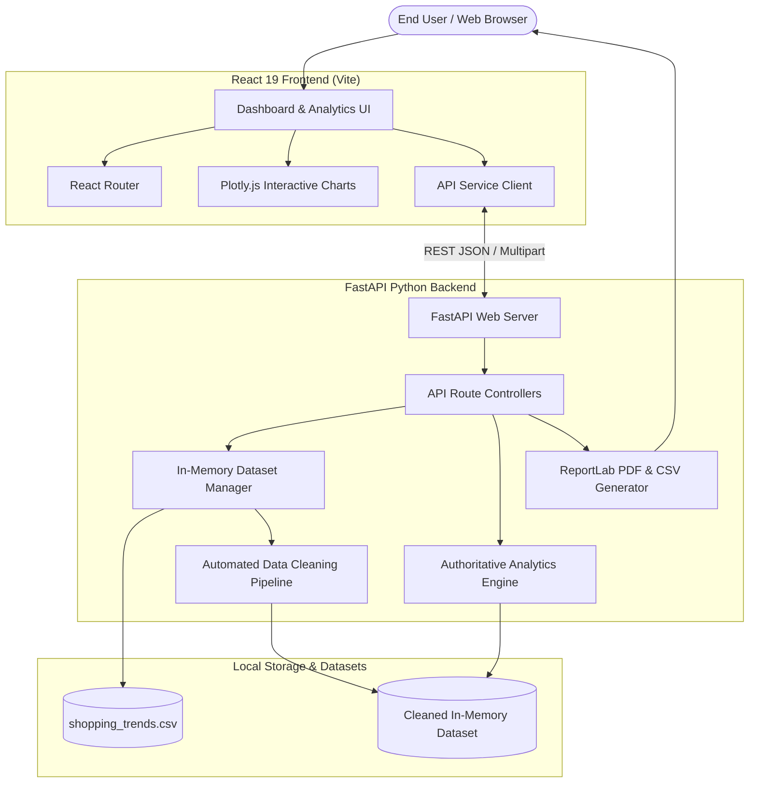

# System Architecture — Retail Customer Behavior & Shopping Trends

## 1. Architectural Overview

The **Retail Customer Behavior & Shopping Trends Analytics Web Application** is designed as a decoupled, multi-tier full-stack system following clean architecture principles.



## 2. Core Architectural Pillars

### A. Strict Data Truth (Zero Fabricated Metrics)
- The backend serves as the sole authoritative source of truth.
- The React frontend does not fabricate or simulate numbers.
- When filters are applied, the backend filters the in-memory Pandas dataframe and recalculates all KPIs, distributions, and insights dynamically.

### B. Two-Dataset Isolation
- **Original Dataset**: Preserved in memory unaltered.
- **Cleaned Dataset**: Produced by a deterministic cleaning pipeline that imputes missing review ratings using Category-level mean/median, strips text whitespace, drops exact duplicates, and standardizes data types.
- Users can preview both versions and toggle between them in the Data Explorer and Reports Center.

### C. Respect for Analytical Restrictions
- The uploaded retail shopping dataset contains 3,900 rows and 18 columns, but **does not contain transaction date columns**.
- The system intentionally does **not** invent historical transaction dates or daily/monthly revenue trends.
- The `Season` column is treated strictly as an independent categorical attribute.
- Metric labels use precise terminology: **Total Purchase Amount** instead of claimed corporate revenue.

---

## 3. Directory Layout

```text
retail-customer-analytics/
├── data/
│   └── shopping_trends.csv          # Real dataset (3,900 rows, 18 columns)
├── backend/
│   ├── app/
│   │   ├── main.py                  # FastAPI application entrypoint & CORS
│   │   ├── config.py                # Configuration constants & dataset paths
│   │   ├── api/                     # REST Route controllers
│   │   │   ├── routes_upload.py     # CSV upload & data cleaning endpoints
│   │   │   ├── routes_dashboard.py  # Overview dashboard KPIs & charts
│   │   │   ├── routes_analytics.py  # Customer & shopping analytics
│   │   │   ├── routes_explorer.py   # Search, sort, filter, pagination
│   │   │   └── routes_reports.py    # PDF and CSV report downloads
│   │   ├── schemas/                 # Pydantic request/response models
│   │   ├── services/                # Business logic services
│   │   │   ├── dataset_manager.py   # Dataset state manager
│   │   │   ├── cleaning_service.py  # Data cleaning pipeline
│   │   │   ├── analytics_service.py # Aggregations & insights
│   │   │   └── report_service.py    # ReportLab PDF & CSV generators
│   │   └── utils/
│   ├── tests/
│   │   └── test_all_endpoints.py    # 12 Pytest test suites
│   ├── requirements.txt
│   └── .env.example
├── frontend/
│   ├── src/
│   │   ├── components/              # Sidebar, Header, PlotlyChart
│   │   ├── layouts/                 # AppLayout & Context
│   │   ├── pages/                   # Dashboard, Upload, Customers, Shopping, Explorer, Reports, About
│   │   ├── services/                # api.js fetch client
│   │   ├── styles/                  # index.css design system
│   │   ├── App.jsx                  # React Router mapping
│   │   └── main.jsx
│   ├── package.json
│   └── vite.config.js
├── docs/
│   ├── architecture.md
│   ├── workflow.md
│   ├── api-design.md
│   └── testing.md
├── README.md
└── .gitignore
```
