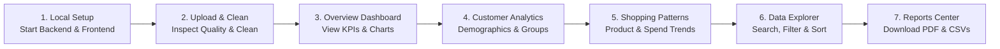

# End-to-End Workflow Guide

Follow this guide to execute the full operational workflow referenced in **Reference Image 2**.



---

## Step 1: Run the Application Locally

1. **Start Backend**:
   ```bash
   cd backend
   python -m pip install -r requirements.txt
   python -m uvicorn app.main:app --reload --host 127.0.0.1 --port 8000
   ```
   - API runs at: `http://localhost:8000`
   - Swagger Documentation: `http://localhost:8000/docs`

2. **Start Frontend**:
   ```bash
   cd frontend
   npm install
   npm run dev
   ```
   - Application interface opens at: `http://localhost:5173`

---

## Step 2: Upload & Data Cleaning (`/upload`)

- Navigate to **Upload & Data Cleaning** in the left sidebar.
- Upload any retail dataset or use the pre-loaded `shopping_trends.csv`.
- Inspect:
  - **Dataset Summary**: 3,900 rows, 18 columns, 416 KB.
  - **Data Quality Check**: Identifies 37 missing values in `Review Rating`, 0 duplicate rows, 18 validated data types.
- Click **Clean Data & Standardize**:
  - Automatically imputes missing review ratings using Category-level mean values.
  - Strips leading and trailing whitespace from string columns.
  - Generates transparent before-and-after audit logs.
- Switch between **Cleaned Data** and **Original Raw Data** preview tabs.

---

## Step 3: Overview Dashboard (`/`)

- Visual layout matches **Reference Image 1**:
  - **5 Top KPI Cards**: Total Customers (`3,900`), Total Purchase Amount (`$233,081`), Average Purchase (`$59.76`), Average Review Rating (`3.8 / 5`), Total Records (`3,900`).
  - **Interactive Plotly Visualizations**:
    - Purchase Amount by Category (vertical bar chart).
    - Customer Distribution by Gender (donut chart with centered count).
    - Top 5 Products by Revenue (horizontal bar chart).
    - Review Ratings by Category (smooth area/line chart).
  - **4 Customer Insights Cards**: Top Location, Most Popular Category, Top Payment Method, Top Shipping Type.
  - **Right-Side Filter Panel**:
    - Filter by Category, Gender, Location, Season, Subscription Status, and Payment Method.
    - Click **Apply Filters** to recalculate all figures and charts dynamically.
    - Click **Clear All** to restore the default state.

---

## Step 4: Customer Analytics (`/customers`)

- Deep dive into demographic segments:
  - **Customers by Age Group**: 18-25, 26-35, 36-45, 46-55, 56+.
  - **Top 10 Locations**: State-by-state customer distribution.
  - **Gender Breakdown**: Male (68%) vs. Female (32%).
  - **Subscription Status**: 27% Subscribed vs. 73% Non-Subscribed.
  - **Previous Purchases Distribution**: Prior transaction frequencies.
  - **Comprehensive Matrix Table**: Age group, customer counts, share %, total spend, avg spend, and subscription rates.

---

## Step 5: Shopping Patterns (`/shopping-patterns`)

- Analyze purchasing habits:
  - **Top 10 Products by Purchase Amount**: Identifies top revenue drivers.
  - **Purchase Frequency Breakdown**: Weekly, Fortnightly, Bi-Weekly, Monthly, Quarterly, etc.
  - **Average Spend by Category**: Clothing, Footwear, Outerwear, Accessories.
  - **Discount Usage**: Used vs. Non-Used transactions.
  - **Payment Methods Volume**: Credit Card, PayPal, Venmo, Cash, Debit Card, Bank Transfer.
  - **Complete 25-Product Ranking Table**: Ranks every catalog item by revenue, count, avg spend, and rating.

---

## Step 6: Data Explorer (`/data-explorer`)

- Interactive record browser:
  - Toggle between **Cleaned Dataset** and **Original Raw Dataset**.
  - Global Search across all fields (Customer ID, Item, Location, etc.).
  - Filter by Category, Gender, and Season.
  - Sort by any column header in ascending or descending order.
  - Select page size: 10, 25, 50, or 100 rows per page.
  - Pagination controls showing "Showing X to Y of Z records".

---

## Step 7: Reports Center (`/reports`)

- Download cards:
  1. **Analytics Report (PDF)**: Executive PDF generated via ReportLab with tables, KPIs, and limitations.
  2. **Cleaned Dataset (CSV)**: Full cleaned dataset with imputed review ratings and normalized text.
  3. **Summary Analytics (CSV)**: Aggregated summaries including KPIs, category metrics, and product rankings.
